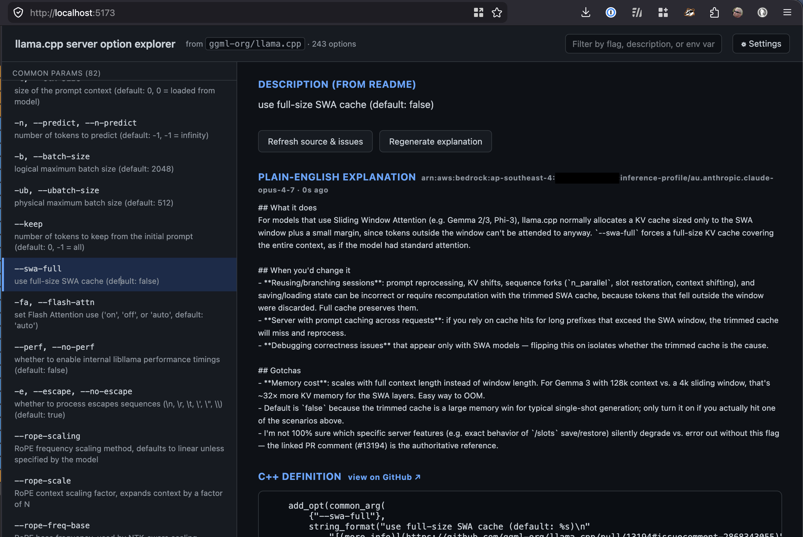
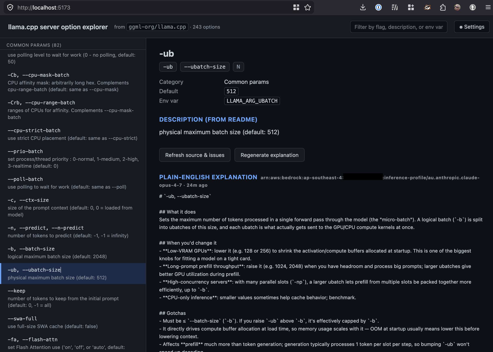
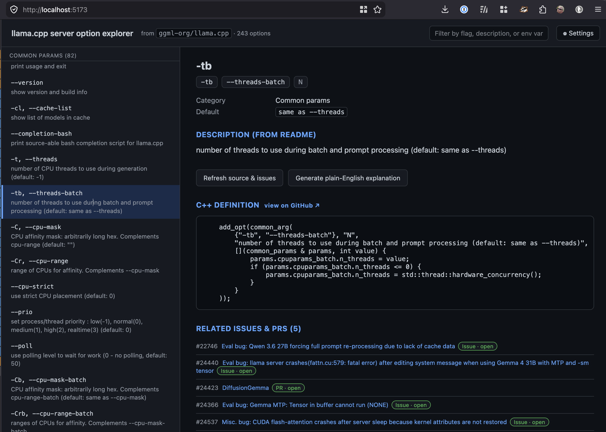
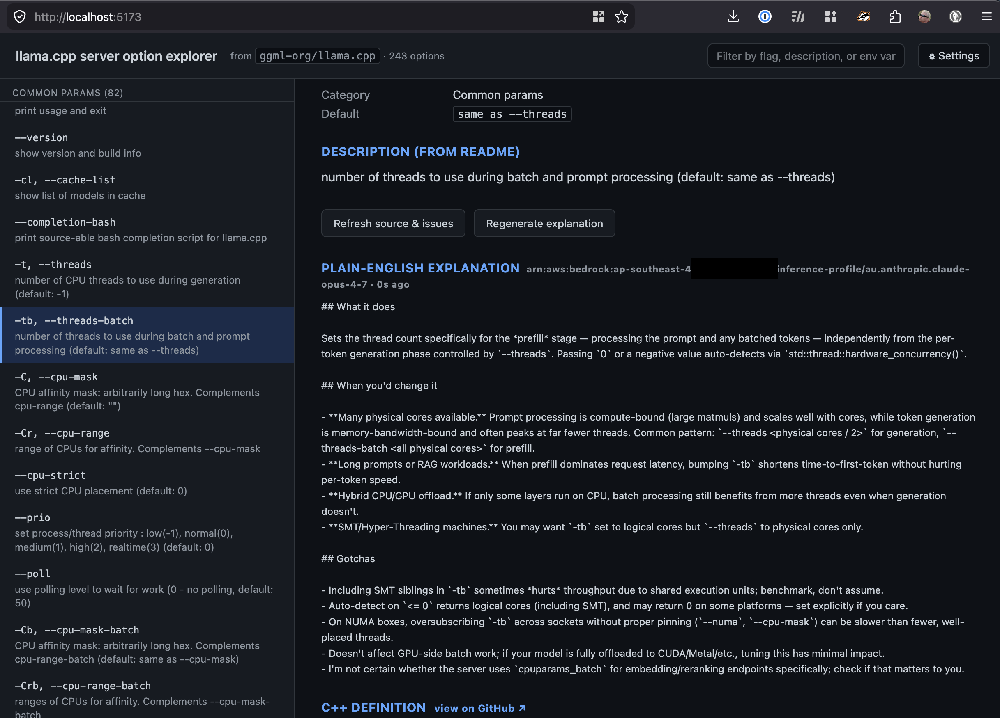

# llama.cpp server option explorer

Local web UI that lets you dig into the CLI options of llama.cpp's tools —
the HTTP server and llama-bench out of the box, with support for adding
custom sources. Each option pulls the README description, the matching C++
definition (when available), related GitHub issues/PRs, and an optional
plain-English explanation generated via a configurable LLM — AWS Bedrock
(Anthropic Claude), any OpenAI-compatible endpoint (Together.ai / OpenAI /
Groq / OpenRouter / vLLM / llama.cpp server / Ollama's OpenAI shim), or
Ollama's native `/api/chat`.

## Contents

- [Screenshots](#screenshots)
  - [Option detail with generated explanation](#option-detail-with-generated-explanation)
  - [Generating an explanation — before / after](#generating-an-explanation--before--after)
- [Stack](#stack)
- [Cache & validation behaviour](#cache--validation-behaviour)
- [Install](#install)
  - [macOS](#macos)
  - [Linux](#linux)
  - [Windows](#windows)
  - [WSL2](#wsl2)
  - [Audit-first install](#audit-first-install)
  - [Run](#run)
  - [Upgrading](#upgrading)
  - [Pre-flight requirements](#pre-flight-requirements)
- [Run from source (development)](#run-from-source-development)
  - [Testing](#testing)
- [Sources](#sources)
- [LLMs](#llms)
- [Settings](#settings)
- [API](#api)
- [LLM auth](#llm-auth)
  - [v2 → v3 migration](#v2--v3-migration)
- [App Generation](#app-generation)
  - [Initial prompt](#initial-prompt)
  - [Clarifying Q&A](#clarifying-qa)
  - [Follow-up requirements (added mid-build)](#follow-up-requirements-added-mid-build)

## Screenshots

### Option detail with generated explanation

Clicking an option opens its detail panel: README description, defaults, env
var, the matching C++ definition (with a link back to the exact line range
on GitHub), and — if you've generated one — a plain-English breakdown of
what the flag does, when you'd change it, and the gotchas. The list on the
left stays available for navigation; selection is highlighted.





### Generating an explanation — before / after

Explanations are generated on demand, not at index time. The README + C++
definition + any related issues are bundled into a single LLM call, the
result is cached server-side keyed by option id, and the button flips from
*Generate* to *Regenerate* once cached. The LLM is picked in Settings →
LLMs; if none is active, the button no-ops cleanly. The C++ definition and related
issues/PRs are visible without an explanation — the LLM blurb is purely
additive context for terse flags.

**Before** — detail panel for `-tb, --threads-batch` showing the C++
definition and 5 related issues/PRs, with the **Generate plain-English
explanation** button waiting to be clicked:



**After** — same option, post-generation. Plain-English explanation appears
inline with timestamp and model id; the button now reads **Regenerate
explanation**. Result is cached so subsequent loads serve instantly:



## Stack

- **Frontend:** Vite + React 19 + TypeScript
- **Backend:** Hono on Node (TypeScript via `tsx` in dev)
- **Cache:**
  - Server-side: SQLite (`better-sqlite3`) — durable, source of truth
  - Client-side: IndexedDB (`idb`) — instant first-paint mirror
- **LLM (optional):** Multi-provider — AWS Bedrock (Anthropic via AWS SDK),
  OpenAI-compatible (Together.ai / OpenAI / llama.cpp server / vLLM / Groq /
  OpenRouter / Ollama's OpenAI shim), and Ollama native (`/api/chat`).
  Configured via Settings → LLMs; gracefully no-ops if no LLM is active.
- **Tests:** `vitest` for schema-migration unit tests, `bash` for install-script
  sync tests, and `@playwright/test` for browser E2E tests of the Settings UI.

## Cache & validation behaviour

- First load (cold cache) → toast `Loading data…`, fetch upstream, store in
  SQLite + IDB.
- Warm load with stale cache (older than `cache_ttl_hours`, default 24h) →
  toast `Refreshing data…`, serve cached immediately, refresh in background,
  re-render if changed.
- Warm load with fresh cache → toast `Cache current (Xh ago)`, no refetch.
- Per-option detail caches source-block, related-issues, and explanation
  separately, each with the same TTL.

## Install

These scripts download a tarball of `main` (no git history) and build it
in place. Re-run to update; your cache survives.

### macOS

```bash
curl -fsSL https://raw.githubusercontent.com/AlienResidents/llama-cpp-server-explorer/main/scripts/install.bash | bash
```

Default location: `~/Developer/llama-cpp-server-explorer/`. To install
elsewhere, pass an absolute path:

```bash
curl -fsSL https://raw.githubusercontent.com/AlienResidents/llama-cpp-server-explorer/main/scripts/install.bash | bash -s -- ~/code/llama-explorer
```

### Linux

```bash
curl -fsSL https://raw.githubusercontent.com/AlienResidents/llama-cpp-server-explorer/main/scripts/install.bash | bash
```

Default location: `${XDG_DATA_HOME:-$HOME/.local/share}/llama-cpp-server-explorer/`.
Same argument-override convention as macOS.

### Windows

```powershell
iwr -useb https://raw.githubusercontent.com/AlienResidents/llama-cpp-server-explorer/main/scripts/install.ps1 | iex
```

Default location: `%LOCALAPPDATA%\llama-cpp-server-explorer\`. To install
elsewhere, download the script first and pass `-InstallDir`:

```powershell
iwr -useb https://raw.githubusercontent.com/AlienResidents/llama-cpp-server-explorer/main/scripts/install.ps1 -OutFile install.ps1
./install.ps1 -InstallDir "C:\opt\llama-explorer"
```

### WSL2

Use the **Linux** command. The install lands in your Linux filesystem,
which is much faster for `pnpm install` and `pnpm build` than the
`/mnt/c/...` Windows filesystem.

### Audit-first install

If you'd rather review the script before running:

```bash
curl -fsSL https://raw.githubusercontent.com/AlienResidents/llama-cpp-server-explorer/main/scripts/install.bash -o install.bash
less install.bash
bash install.bash           # default location
bash install.bash ~/foo     # custom location
```

### Run

```bash
cd <INSTALL_DIR>
pnpm start
# server listening on http://localhost:8787
```

Then open http://localhost:8787 in your browser. The Hono server serves
both the API and the built client from a single port.

### Upgrading

The schema is versioned (currently v3). Migrations run automatically on
startup and are non-destructive — your SQLite cache, custom sources, custom
LLMs, and explanations are preserved across upgrades. See [v2 → v3
migration](#v2--v3-migration) below for what happens to pre-multi-LLM
installs.

**Script install** (macOS / Linux / Windows / WSL2): re-run the same
install command you used originally. The install dir is overwritten in
place, and `data/explorer.db` is preserved.

```bash
# macOS / Linux — same command as install
curl -fsSL https://raw.githubusercontent.com/AlienResidents/llama-cpp-server-explorer/main/scripts/install.bash | bash
# custom location: append `-s -- /path/to/dir` as before
```

```powershell
# Windows — same command as install
iwr -useb https://raw.githubusercontent.com/AlienResidents/llama-cpp-server-explorer/main/scripts/install.ps1 | iex
```

Then `cd <INSTALL_DIR> && pnpm start` as before.

**Git source install** (development checkout):

```bash
git pull
pnpm install --frozen-lockfile
pnpm build
pnpm start
```

If the frontend was already built (`dist/client/` exists), `pnpm start` is
enough — the schema migration runs on boot. Rebuild only if you pulled
client or server source changes.

### Pre-flight requirements

The install script checks for these on PATH:

- `node` (22.12+ or 26+) — install via [nvm](https://github.com/nvm-sh/nvm),
  [fnm](https://github.com/Schniz/fnm), Homebrew, or [nodejs.org](https://nodejs.org/).
- `pnpm` — install via `corepack enable && corepack prepare pnpm@latest --activate`,
  or `npm i -g pnpm`.
- `tar` — standard on macOS/Linux. Windows 10 1803+ ships with native `tar`.
- `curl` — standard everywhere; install via package manager if missing.

## Run from source (development)

If you cloned the repo to develop on it:

```bash
pnpm install
pnpm dev
```

- Frontend (Vite): http://localhost:5173 — hot-reload, proxies `/api` to the backend
- Backend (Hono):  http://localhost:8787 — also serves the built client at `/`
  when `dist/client/` exists (after `pnpm build`)
- SQLite DB: `data/explorer.db` (gitignored)

### Testing

```bash
pnpm test           # vitest unit tests + install-script sync test
pnpm test:unit      # vitest only (schema migration tests)
pnpm test:install   # bash install-script sync test only
```

The vitest suite covers the non-destructive v2 → v3 schema migration:
 fresh installs seed the three default LLMs, upgrades move old
`bedrock_model_id` / `bedrock_region` settings into the `bedrock-default`
LLM row, and pre-existing explanations are preserved with `NULL
explanation_llm_id`. The bash test verifies the install script's
`rsync --delete` sync removes stale files from prior installs (the bug
that left `server/src/bedrock.ts` lingering after the multi-LLM refactor).

Playwright is installed for browser E2E tests of the Settings → LLMs UI;
config and tests are in progress.

## Sources

The app ships with two preset sources:

| ID            | Parser                       | README                                         | C++ definitions      |
| ------------- | ---------------------------- | ---------------------------------------------- | -------------------- |
| `server`      | `server-readme-table`        | `tools/server/README.md`                       | `common/arg.cpp`     |
| `llama-bench` | `llama-bench-usage-block`    | `tools/llama-bench/README.md`                  | (none — see note)    |

llama-bench parses argv inline in `tools/llama-bench/llama-bench.cpp` rather
than via the `add_opt(common_arg(...))` pattern that `arg.cpp` uses, so we
skip the C++-definition lookup for that source. The README description,
related GitHub issues/PRs, and the LLM explanation still work normally.

**Switch source** via the dropdown in the header. Each source has its own
cache namespace — switching is instant; no refetch unless that source's
cache is stale.

**Add a custom source** in Settings → Sources. Provide an ID, a name, the
raw README URL, an optional `arg.cpp`-style URL, the `owner/repo` for
GitHub issue search, and pick a parser. Custom sources can be deleted;
default sources can be edited but not deleted.

## LLMs

The app ships with three preset LLMs, one per supported provider:

| ID                | Provider             | Default target                            |
| ----------------- | -------------------- | ----------------------------------------- |
| `bedrock-default` | `bedrock`            | AWS Bedrock (Anthropic Claude), empty model id |
| `openai-together` | `openai`             | Together.ai, `zai-org/GLM-5.2`, empty api key |
| `ollama-default`  | `ollama`             | `http://localhost:11434`, empty model     |

**Providers:**

- **`bedrock`** — Anthropic Claude via the AWS SDK. Auth comes from the
  environment (`AWS_PROFILE` / `AWS_ACCESS_KEY_ID` / `AWS_ROLE_ARN`). Config:
  `model_id` (foundation-model id or inference-profile ARN) + `region`.
- **`openai`** — Any endpoint that speaks the OpenAI Chat Completions API
  (`POST {base_url}/chat/completions`). Covers Together.ai, OpenAI, Groq,
  OpenRouter, vLLM, and local servers like llama.cpp's `--server` and Ollama's
  OpenAI-compat shim. Config: `base_url` + `api_key` (empty for no-auth local
  servers) + `model`.
- **`ollama`** — Ollama's native `/api/chat` endpoint. Exposes `keep_alive`
  (how long the model stays loaded), which the OpenAI shim doesn't. Config:
  `base_url` + `model` + `keep_alive`.

**Switch active LLM** in Settings → LLMs via the **Set active** button. The
active LLM shows an `active` badge. The Generate button is disabled until the
active LLM is both configured (required fields filled) and has credentials
(env vars for Bedrock, api_key for hosted OpenAI-compat providers).

**Test connection** — each LLM row has a **Test** button that sends a minimal
prompt ("Reply with the single word OK.") to verify the server is reachable,
auth works, the model exists, and can generate. The result appears inline:
green ✓ for pass, red ✗ with the failure reason for fail. The test uses a
separate 30-second timeout (independent of the `llm_timeout_ms` setting) so a
dead server doesn't hang the UI.

**Add a custom LLM** in Settings → LLMs → **+ Add custom LLM**. Pick a
provider, fill the config fields. Provider is immutable after creation —
delete + re-add to change. Custom LLMs can be deleted; default LLMs can be
edited but not deleted.

API keys are stored in plaintext in SQLite. This is acceptable for a
local-only dev tool; don't deploy this app to a shared host without an
auth layer in front.

## Settings

Click **⚙ Settings** in the header. The General tab adjusts:

- Cache TTL (hours)
- Toast duration (ms)
- Issue search limit
- Toggles for source-code lookup, issue lookup, LLM explanation
- Active LLM (read-only here — change via the LLMs tab)
- LLM request timeout (ms) — how long to wait before aborting. Default
  120000 (2 min). Local models may need more on first load; hosted providers
  usually respond in <30s.

The Sources tab manages the source list. The LLMs tab manages the LLM list
(see above). All settings persist server-side in SQLite. Reset returns all
keys to defaults; sources and LLMs are not affected by Reset (delete them
individually if needed).

## API

All source-scoped routes live under `/api/sources/:sourceId/...`. The cache
status is returned in every payload as `{ data, cache: { age_ms, status, was_refreshed } }`.

| Method | Path                                                | Purpose                                  |
| ------ | --------------------------------------------------- | ---------------------------------------- |
| GET    | `/api/meta`                                         | Boot info: settings, sources, llms, availability |
| GET    | `/api/settings`                                     | Current settings + defaults              |
| PUT    | `/api/settings`                                     | Patch settings                           |
| POST   | `/api/settings/reset`                               | Reset to defaults                        |
| GET    | `/api/sources`                                      | List sources                             |
| POST   | `/api/sources`                                      | Create custom source                     |
| PUT    | `/api/sources/:id`                                  | Update source                            |
| DELETE | `/api/sources/:id`                                  | Delete source (non-default only)         |
| GET    | `/api/llms`                                         | List LLMs                                |
| POST   | `/api/llms`                                         | Create custom LLM                        |
| PUT    | `/api/llms/:id`                                     | Update LLM                               |
| DELETE | `/api/llms/:id`                                     | Delete LLM (non-default only)            |
| POST   | `/api/llms/:id/test`                                | Test LLM connection (200 always)         |
| GET    | `/api/sources/:id/options[?force=1]`                | Options for a source                     |
| GET    | `/api/sources/:id/options/:opt[?force=1]`           | Option detail                            |
| POST   | `/api/sources/:id/options/:opt/refresh`             | Force-refresh source + issues            |
| POST   | `/api/sources/:id/options/:opt/explain`             | Generate LLM explanation                 |

All `GET` payloads are wrapped as `{ data, cache: { age_ms, status, was_refreshed } }`.

## LLM auth

**Bedrock:** uses the default AWS SDK credential chain. Easiest local setup:

```bash
export AWS_PROFILE=...           # or use ambient creds
export AWS_REGION=ap-southeast-4 # or whichever holds your inference profile
pnpm dev
```

Then open **Settings → LLMs**, edit the `bedrock-default` LLM (or create a
custom one), and set `model_id` to your inference-profile ARN or a
foundation-model id. The app ships with an empty `model_id` so it stays
usable without AWS, and the **Generate explanation** button no-ops cleanly
until both creds and a model id are present.

**OpenAI-compatible:** auth is the `api_key` field on the LLM config. For
hosted providers (Together.ai, OpenAI, Groq, OpenRouter), set it to your API
key. For local servers (llama.cpp, Ollama's OpenAI shim), leave it empty —
those don't require auth.

**Ollama native:** no auth. Just set `base_url` (default
`http://localhost:11434`) and `model` (as `ollama list` shows it).

### v2 → v3 migration

If you're upgrading from a pre-multi-LLM install (schema v2), the migration
is automatic and non-destructive:

- `bedrock_model_id` and `bedrock_region` settings are moved into the
  `bedrock-default` LLM row, and `active_llm_id` is set to `bedrock-default`
  so your existing setup keeps working without a Settings visit.
- The old `bedrock_model_id` / `bedrock_region` settings keys are deleted.
- Existing explanations in `option_details` are preserved. They show the raw
  model id (e.g. `anthropic.claude-3-opus`) instead of an LLM name, since
  they pre-date the `explanation_llm_id` column.
- The `llms` table is created and seeded with the three defaults above.
- `option_details.explanation_llm_id` is added via `ALTER TABLE` (existing
  rows get `NULL`).

## App Generation

This app was generated by Claude (Opus 4.7, 1M context) running inside the
[`pi`](https://github.com/earendil-works/pi-coding-agent) coding agent harness,
from the prompts and answers below. Captured verbatim so the design choices
are traceable to the conversation that produced them.

### Initial prompt

> Heya Kestrel! I'd like to build a webapp that takes this readme:
> https://github.com/ggml-org/llama.cpp/blob/master/tools/server/README.md
> and allows a user to dig into the various options for more detailed
> information. I'd like each time a user digs into a particular option, that
> the online source is validated asynchronously for currency. On first load,
> cache all validations, and subsequent serves load cache first with a toast
> saying refreshing data and then dynamically update the content/cache if
> different.

### Clarifying Q&A

**1. Tech stack?** (Next.js / Vite+React / Flask+HTMX / static + service worker)

> Vite + React

**2. Where does it run / where do I create it?**

> Let's store it locally for the time being, so we can test. I'll run it as
> localhost or something first, suggestions for a webserver component would
> be nice.

**3. What is "more detailed information" for an option?** (`arg.cpp` block /
linked issues+PRs / LLM-generated explanation / all of the above)

> The terms used need to be explained e.g. `-cms minimum spacing between
> context checkpoints in tokens` — what does that even mean, and why would
> you change it? All of the above would be a nice thing to have.

**4. What does "validate for currency" mean?** (re-fetch README / re-fetch
source and check flag still exists / both)

> Both

**5. Cache location?** (server-side / client-side / both)

> Both — only update cache if older than a configurable period, default to
> 1d/24h.

**6. Toast UX — confirm the flow.**

> Always show toast. On cold first load, make the toast say `Loading data...`
> and refresh `Refreshing data...` if cache is stale, and for non-stale cache
> `Cache current ($age)`. Keep the toast around for a configurable time
> period, with a default of 2s.

### Follow-up requirements (added mid-build)

**Settings UI.**

> I'd like a settings section so I can update settings through the webui.

**Dependency hygiene.**

> When building this, ensure you have the latest non-vulnerable versions of
> software, and validate online.

Resolved by checking each chosen package's `@latest` version against the
GitHub Security Advisories API for the `npm` ecosystem before pinning. Every
chosen version sits above the highest patched range listed for that package
at the time of writing — see the pinned versions in `package.json`.
